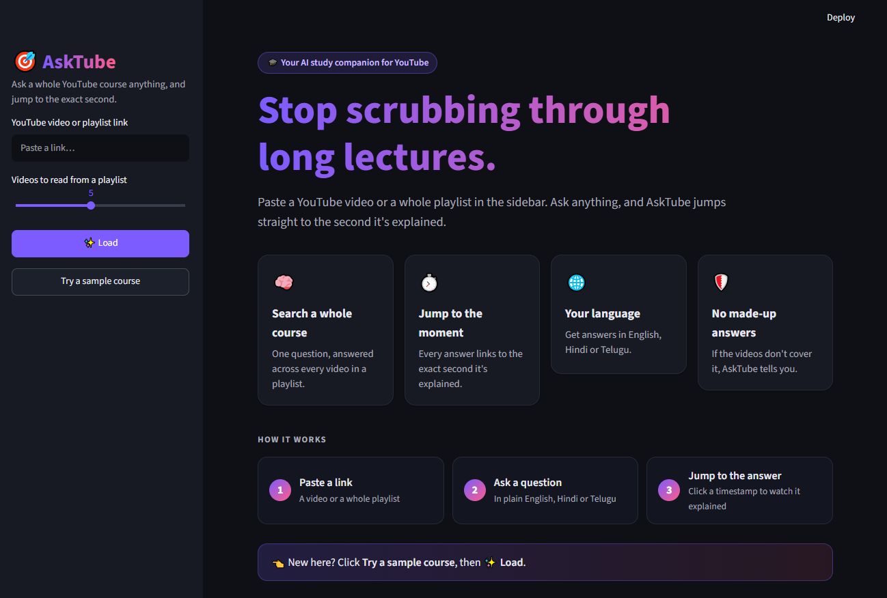

# 🎯 AskTube

**Stop scrubbing through long lectures.** Ask any question about a YouTube video, or a whole playlist, and jump straight to the exact second it's explained.

YouTube's built-in AI answers questions about **one video at a time**. AskTube searches an **entire course**: ask once, and it tells you *which video* and *which second* covers your answer.

🔗 **Try it live:** https://asktubee.streamlit.app/




## ✨ Features

- **🧠 Search a whole course:** load a playlist and ask one question across every video in it
- **⏱️ Jump to the moment:** every answer comes with clickable timestamps that play the video from that exact second
- **🌐 Your language:** get answers in English, Hindi or Telugu
- **🛡️ No made-up answers:** if the videos don't cover a question, AskTube says so instead of guessing
- **🔗 Any link works:** paste a video link, a playlist link, or a video-inside-a-playlist link; AskTube cleans it up
- **⚡ Built to keep going:** automatic retries for API rate limits, and a backup model when the main one is busy

## 🛠️ How it works

AskTube is a **RAG (Retrieval-Augmented Generation)** app built from scratch, without a framework, so every step is visible in the code.

```
                 ┌──────────── Indexing (once per video) ────────────┐
YouTube link ──► transcript ──► 60-second chunks ──► embeddings ──► ChromaDB
                                (with timestamps)    (Gemini)       (vector store)

                 ┌──────────── Answering (every question) ───────────┐
Question ──► embedding ──► find closest chunks ──► Gemini writes answer ──► answer + timestamps
                           (cosine similarity)     from those chunks only
```

1. **Load:** fetch the video transcript with timestamps
2. **Split:** group it into ~60-second chunks, each remembering its start time and video
3. **Embed:** turn each chunk into a vector with Gemini's embedding model
4. **Store:** save the vectors in ChromaDB (videos already stored are skipped, so nothing is embedded twice)
5. **Retrieve:** embed the question and find the most similar chunks; weak matches below a similarity threshold are dropped
6. **Augment:** put the matching chunks, with their video titles and timestamps, into the prompt
7. **Generate:** Gemini answers using only those chunks and returns structured JSON listing which chunks it used, which become the timestamp links

## 🧰 Tech stack

| Part | Tool |
|---|---|
| Language | Python |
| LLM & embeddings | Google Gemini API |
| Vector database | ChromaDB |
| Transcripts | youtube-transcript-api |
| Playlist & video info | yt-dlp |
| Interface | Streamlit |

## 🚀 Run it locally

**1. Clone the repo**
```bash
git clone https://github.com/bbhavanar/asktube.git
cd asktube
```

**2. Install the libraries** (Python 3.9+)
```bash
pip install -r requirements.txt
```

**3. Add your Gemini API key**

Get a free key at [Google AI Studio](https://aistudio.google.com), then create a file named `.env`:
```
GEMINI_API_KEY=your_key_here
```

**4. Start the app**
```bash
streamlit run app.py
```

Open http://localhost:8501, click **Try a sample course**, then **✨ Load**.

> The free Gemini tier allows a limited number of embeddings per minute, so loading several new videos can pause for a minute while AskTube waits. Videos you've loaded before are instant.

## 📁 Project structure

| File | What it does |
|---|---|
| `app.py` | The Streamlit interface |
| `asktube_core.py` | The engine: links, transcripts, chunking, embeddings, retrieval, answers |
| `step1_transcript.py` … `step4_ask.py` | The project built step by step in the terminal, one RAG stage per file |
| `store_playlist.py`, `ask_playlist.py` | Terminal versions of playlist indexing and cross-video search |

## 🗺️ Roadmap

- [ ] Auto-generated notes and quizzes for each video, linked to timestamps
- [ ] Upload your own recordings (class recordings, podcasts) using speech-to-text
- [ ] Deploy a live public version

## 👤 Author

**K. Nishanth Reddy** · [GitHub](https://github.com/bbhavanar)